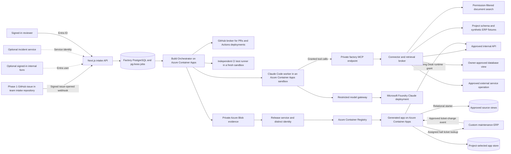

# Azure Software Factory architecture proposal

**Phase 1 delivers a production factory by replacing one team’s legacy app.** The factory generates Screening Desk to take over the old shift tracker’s open work. One snapshot migrates issues, owners and notes. A separate read-only booking feed is the only ongoing business integration. Allow three weeks for discovery and access. Target an app-producing internal beta around Week 10. Keep beta live for feedback intake and monitoring until sponsors and operators have enough evidence to recommend release. Production release and handover conclude delivery. The estimate assumes one team, one approved repository and one maintained template. Integrations and network paths require validation in the target subscription. Project Library illustrates the relational starter. The [Screening Desk presentation](../presentation/PRESENTATION_SITE_SPEC.md) illustrates an internal API, permission-filtered retrieval, and an independently chosen application store.

**Phase 2 extends the running factory after handover.** Use observed demand to select a tool backed by a database, a legacy system, an external service or an ERP, or to onboard the next team. The [delivery plan](BETA_TO_PRODUCTION_SPEC.md) estimates just the ERP lookup and defines the acceptance checks. The first team continues using the service during expansion.

## 1. Product scope

**Working assumptions.** The team understands the software factory concept and wants to see how to put it into practice. Use worked examples to show who approves ERP access and how an engineer verifies a bug fix before release. GitHub and Azure are already in use across an ecosystem of legacy applications, an ERP, databases and external services. Require each delivery approach to fit the workload’s existing interfaces, ownership boundaries and release controls. Prior factory experience can supply templates, runbooks and known failure cases. During discovery, check candidate assets against the current identity, network, ownership and review requirements.

An internal requester can describe a greenfield website or web app, review a proposed plan, and follow it from milestones to a deployed release. Claude Code produces patches, tests, documentation, and operational changes within an approved work item. The platform owns credentials, workflow state, verification, and releases. Engineers review the evidence and make decisions on changes that need their judgment.

The first release supports one organization, one preapproved GitHub organization and one maintained Next.js template. Site projects and database-backed apps share the same factory lifecycle. Pilot support covers changes to repositories created by the factory. Existing-repository import, arbitrary stacks, native mobile apps, shared public sign-up, and production access for the agent are deferred.

A project is ready to hand over when its private repository includes runnable source, a lockfile, unit and integration tests, a browser smoke suite, Docker and local run instructions, an environment variable inventory, and a release and rollback runbook. Every published version links its commit, image digest, evidence, and approval. Action status, failure diagnostics, source, and evidence remain accessible after an agent session ends.

**Project Library example.** A team requests a searchable project catalog and editor-only review notes. Milestone 1 delivers browsing against deterministic fixtures. Milestone 2 validates read-only source access and persistent notes in the app-owned database. Milestone 3 publishes the approved app and rehearses rollback. Catalog export is a separate slice with unresolved decisions about access and fields. The factory records the open questions and their owners. Browse and filter can ship while export waits for an explicit decision. A later copy change can qualify for low-risk automation after calibration. Changes to editor privileges or the database schema follow the higher-risk route.

**Legacy cutover in Phase 1.** Rehearse against a representative export in restricted staging. Use stable old issue IDs for repeatable imports. Compare the count, identifiers, bookings, owners, due times and notes with the source. At cutover the operator freezes legacy edits and imports the final snapshot. A missing item or mismatch holds the switch. The operations lead accepts the new register after a shift handover. The old tracker then serves historical reads only. If switching back after new writes, first preserve and reconcile those changes. The full [delivery plan](BETA_TO_PRODUCTION_SPEC.md) defines the readiness assumptions.

**Onboarding a second team.** If onboarding is the next priority after Phase 1 handover, use Project Library to demonstrate repeatability. The portfolio team supplies a sponsor, repository owner, approved catalog view, editor policy, acceptance examples and release owner. The factory reuses the versioned starter, protected verifier and release process. It provisions a separate repository, grants, app store and target for the portfolio team. Verify that an editor can save a review note on the Depot retrofit entry, a viewer cannot write and a Screening Desk account cannot open the portfolio preview. Estimate this onboarding against the team’s own access and data contracts.

## 2. Technology choices and Azure topology

### Reuse before building

We considered Claude Code’s GitHub integration and chose an Azure-hosted worker for flexibility. The Build Orchestrator lets the platform team add intake channels and tailor connector grants and approval rules to each project. It starts the Claude Agent SDK in a temporary Azure Container Apps sandbox for each coding attempt. Engineers still review pull requests in GitHub and release owners approve production through GitHub Actions. [Claude Code GitHub Actions](https://code.claude.com/docs/en/github-actions)

Based on public documentation reviewed November 18, 2026. Existing tools cover much of the path from a specification to a PR. The factory's responsibilities are the durable project plan, sponsor-scoped writes, durable work items, independent evidence tied to the candidate commit, and the Azure release decision.

| Layer | Recommended foundation | What the factory still owns |
| --- | --- | --- |
| Requirements and work breakdown | **GitHub Spec Kit** provides Claude Code-compatible templates and workflows for specifications, plans, checklists, and tasks. **Backstage Software Templates** can scaffold and publish an approved repository if already deployed. [Spec Kit](https://github.github.com/spec-kit/) · [Backstage templates](https://backstage.io/docs/features/software-templates/) | Versioning approved scope, scheduling milestones, and authorizing repository creation. |
| Coding and isolation | **Claude Agent SDK** using Microsoft Foundry, with one **Azure Container Apps Sandbox** per coding attempt and a fresh sandbox for verification. [Agent SDK](https://code.claude.com/docs/en/agent-sdk/overview) · [Foundry integration](https://code.claude.com/docs/en/microsoft-foundry) · [Azure sandboxes](https://learn.microsoft.com/en-us/azure/container-apps/sandboxes-overview) | Scoped model access, independently run acceptance checks, and separate write and release identities. |
| Bounded jobs and durable state | **pg-boss** uses PostgreSQL for transactional scheduling, retries, and job expiry. **Azure Durable Functions with Durable Task Scheduler** is the first upgrade candidate if the team needs parallel orchestration, durable approval waits, or timers across many workflows. [pg-boss](https://pgboss.io/introduction) · [Azure TypeScript sample](https://learn.microsoft.com/en-us/samples/azure-samples/durable-functions-quickstart-typescript-azd/starter-durable-fan-out-fan-in-typescript/) | Task dependencies, human approvals, progress checkpoints, and reconciliation of external writes. |
| Repository automation | **Anthropic's Claude Code GitHub Action** supports Microsoft Foundry via OIDC and can prove one issue-to-PR path. **GitHub Agentic Workflows** runs Claude Code and separates agent execution from constrained PR writes through its Safe Outputs mechanism. [Claude Code Action provider setup](https://github.com/anthropics/claude-code-action/blob/main/docs/cloud-providers.md) · [Agentic Workflows Claude engine](https://github.github.com/gh-aw/engines/claude/) · [PR safe outputs](https://github.github.com/gh-aw/reference/safe-outputs-pull-requests/) | Protected checks, sponsor delegation, and the Azure release decision. Validate GitHub Agentic Workflows' Foundry path separately before adopting it. |

Temporal is a credible workflow engine if the organization already operates it. Self-hosting adds an operational service, while Temporal Cloud on Azure is in public preview. LangGraph provides checkpointed agent graphs and human interrupts for complex planning. Evaluate it if planning outgrows one Claude Code session. GitHub Actions is well suited to bounded repository jobs and CI, with a 35-day workflow limit including waits. [Temporal self-hosting](https://docs.temporal.io/self-hosted-guide) · [Temporal Azure preview](https://temporal.io/changelog/temporal-cloud-on-azure-is-in-public-preview) · [LangGraph interrupts](https://docs.langchain.com/oss/javascript/langgraph/interrupts) · [GitHub Actions limits](https://docs.github.com/en/actions/reference/limits)

**Delivery platform.** The organization ruled out AI app builders for this project and chose a software factory. Teams need to adapt connectors to legacy applications, databases, ERP installations and external services as their interfaces and access rules change. Engineers own the adapter code and tests in GitHub. A change to one adapter goes through independent verification and a controlled release to the app’s Azure environment.

### Closest packaged alternatives

| Product | What it already does | Constraint for this proposal |
| --- | --- | --- |
| **GitHub's Claude coding agent** | Uses the actual Claude Agent SDK and turns an issue or prompt into a PR. [GitHub third-party agents](https://docs.github.com/en/copilot/concepts/agent-capabilities/about-agents/about-third-party-coding-agents) | Strong existing-repo benchmark if paid Copilot and preview features are approved. Validate the exact partner-agent execution location and network route before relying on customer-controlled Azure compute. |
| **Claude Code cloud sessions with self-hosted environments** | Runs Claude Code sessions on your own compute and supports parallel project threads and PR follow-up. Self-hosted environments are in public beta on Team and Enterprise. [Cloud sessions](https://code.claude.com/docs/en/claude-code-on-the-web) · [Self-hosted environments](https://code.claude.com/docs/en/self-hosted-environments) | Customer-managed execution still uses Anthropic's cloud session service. Confirm queue, transcript, and inference boundaries before treating it as a fit for a Foundry-backed factory. |
| **Jira Coding Agent** | Converts a Jira work item into a linked draft PR in GitHub or Bitbucket. [Atlassian Jira Coding Agent](https://support.atlassian.com/jira-software-cloud/docs/generate-code-from-a-work-item-in-jira/) | Useful for a Jira-first workflow. Uses Atlassian's sandbox and routes merge through humans. |
| **Factory Droids** | Runs repo automations from events, schedules, and webhooks. Factory Private can put Droid sandboxes in a customer VPC. [Factory automations](https://docs.factory.com/automations/custom) · [Deployment options](https://docs.factory.com/enterprise/network-and-deployment) | Uses its Droid runtime, and its control plane is Factory-hosted by default. A candidate if those boundaries are negotiable. |
| **Coder Workspaces** | Provisions standardized workspaces that can run Claude Code on organization-managed compute. [Coder AI agents](https://coder.com/docs/ai-coder/) · [Claude Code Agent Relay](https://coder.com/docs/ai-coder/agent-relay/claude-code/) | A possible execution adapter if Coder is already operated. Isolation depends on the workspace template. Its beta relay uses Claude cloud sessions and carries separate inference and data requirements. |
| **OpenHands Enterprise** | Offers private-cloud coding-agent workspaces, enterprise identity, and bring-your-own model configuration. [OpenHands Enterprise](https://docs.openhands.dev/enterprise) | Uses the OpenHands runtime. Evaluate its model endpoint, Jira integration, and isolation against the proposal's requirements. |
| **Self-hosted Claude Managed Agents** | Runs Anthropic's agent service, history, and workers on organization infrastructure with Microsoft Foundry as an inference option. [Anthropic self-hosting](https://platform.claude.com/docs/en/managed-agents/self-hosted) | A separate agent runtime. Distribution requires Anthropic account-team access, and the factory still owns the release and approval policy. |

**Greenfield benchmark.** Replit Agent illustrates the experience of turning a brief into an app, splitting work into background drafts, reviewing a preview, and exercising browser tests. Use it as a reference for the intake and review experience. This proposal requires separate evidence and Azure release controls. [Replit Task Board](https://docs.replit.com/references/agent/task-board) · [Replit App Testing](https://docs.replit.com/features/agent/app-testing)

**Optional engineering benchmark.** When a reuse decision is open, compare the Claude Code Action in a disposable repo with the direct SDK and Azure Sandbox path on the same synthetic brief. Measure setup time and reviewer effort. Require exact-SHA evidence, rejection of a stale approval and revoked sponsor, and one deferred work item that allows independent work to continue. Credit time savings in the delivery estimate only after the relevant authorization, data, evidence, and release controls pass in the target setup.

### Web stack and Azure topology

Use Next.js App Router, React, TypeScript, and a supported Node.js LTS for the factory web app and the generated template. Use a separate TypeScript service, the Build Orchestrator, for long-running orchestration, a small typed SQL layer with checked-in migrations, PostgreSQL, Vitest, and Playwright. Pin toolchain versions, base images, and dependency lockfiles. Next.js can produce a standalone Node container or a static export for a content-only site. The first release uses standalone containers for the factory and generated apps so staging and production exercise the same runtime. [Next.js deployment](https://nextjs.org/docs/app/getting-started/deploying)

One supported template gives the pilot team a single build, test, preview, and deployment path to validate end to end. The orchestrator handles retries and cancellation across jobs that outlive the request that started them.

Run the trusted web/API, Build Orchestrator, and model gateway as Azure Container Apps. The orchestrator invokes the Azure Container Apps Sandboxes data plane and keeps Azure credentials outside the sandbox. Start with pg-boss on PostgreSQL and transactional job submission. Revisit Azure Service Bus when measured throughput or cross-service consumers justify a separate message bus. Private Link requires a Premium namespace. Private Blob Storage holds source snapshots, reports, and evidence under project and run IDs with content hashes. Azure Container Registry holds trusted runner images and verified deployment images. Key Vault holds integration credentials scoped to their designated services. Azure Monitor and Application Insights receive correlation IDs, state transitions, resource events, and redacted diagnostics. Use Bicep and distinct environments for development, staging, and production. [pg-boss delivery semantics](https://pgboss.io/introduction) · [Service Bus Private Link](https://learn.microsoft.com/en-us/azure/service-bus-messaging/private-link-service)

**Data ownership.** Factory PostgreSQL Flexible Server tracks memberships, plan versions, leases, approvals, evidence references, release records, and audit events. It uses private connectivity, separate application and migration roles, backups, and a tested point-in-time restore. Each generated project registers its approved source and chooses a store for the records it owns. Project Library illustrates read-only views on a replica and separate PostgreSQL databases for app writes in staging and production. Screening Desk reads bookings, master deadlines and delivery status from the programming API. The operations lead records a follow-up owner and time in the app’s Azure SQL store. An assignment must leave a missing overdue master visible until receipt is confirmed by the source. Confirm the fields exist in one approved feed during discovery. SQL Server, MySQL, PostgreSQL, and document-store adapters qualify per project through the [evaluation](STATE-OF-ART-EVALUATION.md#5-review-of-the-expanded-screening-desk-proposal). Keep source and app permissions distinct, isolate environments, and exercise the selected engine’s recovery procedure. A static site can omit app storage. The generator sees only approved projections returned by its broker. Verification uses isolated fixtures. [Azure data models](https://learn.microsoft.com/en-us/azure/architecture/guide/technology-choices/data-store-overview)

**Development and verification fixtures.** The factory's Docker Compose profile starts its own Postgres with idempotent migrations and seeds, test users, and fake integration adapters. The Project Library repository supplies two separate Postgres Compose services. The source fixture exposes synthetic catalog rows through designated views with a fixture-only read identity. The app fixture supports editor annotations and applies app migrations and seeds. Distinguish ports, database names, identities, volumes, and connection variables. Tests must show that intended views are readable, other source objects and replica writes are denied, and authorized app writes succeed only in the app-owned store. Each verification attempt starts fresh fixtures, applies app migrations from empty and from the prior supported schema where applicable, and tears them down. Use trusted prebuilt containers or equivalent Postgres fixtures inside the microVM without a host Docker socket.

For Screening Desk, substitute a deterministic programming API and a SQL Server-compatible notes fixture. Validate Azure SQL-specific identity, migration, and restore behavior on the approved staging target. Preload locked packages, test browsers, and fixtures in the trusted verifier image so a clean run can complete with outbound traffic denied.

## 3. Durable project and run workflow

In Phase 1, a team member requests a change by opening a GitHub issue in the team’s registered intake repository. This repository exists before a new app is scaffolded. A GitHub App sends the `issues` event with action `opened` to the Next.js intake API. Verify the webhook signature, installation and repository, and map the issue author to an authorized requester. Store the repository ID and issue ID as a unique intake key so a redelivery returns the existing request. Starting the coding agent requires sponsor-approved scope or a matching standing repair policy. [GitHub webhook events](https://docs.github.com/en/webhooks/webhook-events-and-payloads#issues)

**Additional intake channels.** After the pilot, a team could submit the same request from an Entra-authenticated form or an approved internal service. Each adapter authenticates its caller and checks the caller’s grant to submit for the target team. Record the team, channel, verified requester, stable source reference and expected outcome. For a form or API submission, scope its idempotency key to the team, caller and channel. A retry returns the existing factory request ID. GitHub keeps its repository and issue IDs as the source reference. Every channel uses the same scope or repair-policy check before a job enters the Build Orchestrator’s queue. A form or service can submit directly without creating a GitHub issue.

1. **Intake.** Collect the problem, expected outcomes, example scenarios, data classification, target personas, and deployment owner. For a bug report, capture the affected route, environment or revision, requester role, expected and observed behavior, and steps to reproduce. Accept sanitized evidence when available. Redact secrets and personal data before storage or model access. Use an idempotency key for submission retries and suggest duplicates using the repository, affected route, and normalized symptom. Requester or sponsor confirmation determines whether to link requests. Route incomplete or ambiguously owned work to clarification before scheduling.
2. **Route by scope and risk.** For a reproducible, bounded bug in an existing repository, use an active sponsor-authorized repair policy when the expected behavior, allowed paths, acceptance check and rollback are known. Record the work-item ID, policy version, current sponsor grant, pinned base and expected outcome, then dispatch the fix directly. This permits automatic implementation and verification without a separate planning ceremony. Recheck the actual candidate before deciding whether the broker may merge. For a new capability, ambiguous behavior or a change to data, permissions or scope, propose a versioned plan with slices, dependencies, acceptance criteria, approximate effort, data needs, and risk. The project sponsor approves the plan version and confirms the GitHub target. The platform checks that the dependency graph is acyclic and each work item has a bounded deliverable and testable outcome. Store the approved plan and evidence with immutable IDs. A plan can remain active for weeks while short-lived run grants are minted separately.
3. **Scaffold a new project when needed.** Existing-project repairs start from the pinned repository. Provision a private repository only after project approval. A separately authorized bootstrap identity creates the repository from the maintained template and installs protection rules, service access, and trusted checks. Confirm that no workflow with secrets or a privileged identity can run candidate-branch code. Bind the project to the GitHub numeric repository ID, permitted target branch, template version, and verification policy version before allowing work.
4. **Execute a ready work item.** Claim its lease, check dependencies and authority, snapshot the current approved base, and transfer only that source, work specification, and relevant guidance to a fresh sandbox. Start Claude Code with factory-owned settings and the local tools required for the task. When the task has a project read grant, configure the factory MCP endpoint and its individual tools in code. Disable discovery of checkout settings, hooks, MCP servers, plugins, and memory. Collect a bounded patch. Treat source, retrieved material, PR text, email text, and model output as untrusted context.
5. **Verify and review.** The broker creates a short-lived work branch and submits candidate changes under the sponsor's GitHub identity. An independent verifier fetches the candidate Git object, builds with trusted runners, and records results from that artifact. Show the PR diff, gate status, tests executed, screenshots, and residual issues. Retain prior passed work as a milestone checkpoint if a later run fails.
6. **Merge and release.** Apply approval and release policy per work item. Use a fresh grant for follow-on work and check the now-current base. A scope change creates a new plan version and requires approval for affected work. A cancelled or obsolete work item can be resumed only through a new attempt and authorization decision. Record the release separately from merge.

### Coding and verification roles

Phase 1 uses a Claude Code builder with four available read-only specialists in its coding sandbox. For the legacy replacement, the builder delegates discovery before implementation, then requests code, security/data-access and UX/accessibility reviews of the patch as applicable. A bounded query fix can use the builder alone. Factory-owned SDK configuration sets each role’s tools. Policy specifies which reviews are required. Findings are recorded against the candidate. Missing required reviews hold the change for an engineer. Child calls share the run budget. A specialist requiring privileged tools needs a separate job and identity. [Claude Agent SDK subagents](https://code.claude.com/docs/en/agent-sdk/subagents)

The shared Build Orchestrator uses deterministic rules without an LLM. It starts the authorized coding attempt, persists progress, dispatches verification and enforces the repair limit. Verification is a protected CI job with no Claude session. It runs the same trusted regression check on the base and candidate and records the result for each revision. One successful coding and verification cycle uses two temporary sandboxes in sequence. One repair and retest allocate a fresh pair, four in total across that run. Shared services, generated app instances and infrastructure retries are outside that example. An optional future test-design subagent can propose cases for engineers to adopt.

### Knowledge plane

In Phase 1, keep the starter’s approved runbook, schema and examples under version control. Retrieve the named version after checking project access, cite it in the run and search the pinned checkout for affected callers and tests. Escalate unresolved impact to the engineer. If Phase 1 evidence shows that exact lookup or source search regularly misses relevant guidance, Phase 2 can evaluate managed hybrid retrieval or a repository index against those missed cases.

### Agent access through MCP

Expose one private Model Context Protocol (MCP) endpoint on the existing connector and retrieval broker. The Claude Agent SDK acts as the client in the generation sandbox. The server translates named tool calls into approved system-specific operations for legacy applications, databases, external services, project guidance and ERP integration fixtures. Each source owner registers the permitted inputs, output fields and authorization scope. A future write tool requires its own approval and retry policy. Phase 1 covers one live upstream adapter, the legacy schedule read. Guidance and schema tools use approved files packaged with the starter. A portfolio view, a partner API and ERP fixtures belong to later extensions. Use the factory-configured HTTPS endpoint with Streamable HTTP and an explicit per-task tool list. A local, reproducible repair needs only its checked-out source and test fixture. [Claude Agent SDK MCP configuration](https://code.claude.com/docs/en/agent-sdk/mcp)

| When the agent needs context | MCP tool | What the broker may return |
| --- | --- | --- |
| Build Screening Desk or add a handoff note | `search_project_guidance` | Cited excerpts from the approved runbook or ERP contract, filtered by current project membership and document access. |
| Build the escalation list | `get_schedule_sample` | A bounded sample of bookings, master deadlines and receipt status from the legacy programming adapter for the festival in the grant. |
| Bind the room view | `describe_app_schema` | Approved field names, types and relationships from the pinned app schema. The generated app reads room records with its own runtime identity. |
| Inspect an authorized portfolio entry | `get_catalog_entry` | Optional database adapter. Look up one project ID through an approved view and return the permitted title and phase. Qualify adapters for the project’s SQL Server, PostgreSQL or MySQL source separately. |
| Integrate a partner service | `get_delivery_status` | Optional external API adapter. Check the shipment reference against the grant and use the carrier’s approved endpoint to return status and update time. Keep the carrier credential with the broker. |
| Develop the handoff-note feature | `get_erp_ticket_fixture` | A versioned synthetic maintenance ticket from the approved fixture catalog. After release the app uses its own ERP connector to read the assigned hall’s ticket. The coordinator confirms the note before the app saves it to its database. |

Validate the short-lived access token’s issuer, expiry and MCP resource audience. For each call, intersect the active sponsor and run grants with project, environment, tool, resource and source permissions. Use broker-held credentials for upstream calls. Record the run, tool, resource scope, authorization decision and duration with redacted identifiers. Keep GitHub writes, database migrations and release approvals on their existing identities and workflows. [MCP authorization](https://modelcontextprotocol.io/specification/2025-11-25/basic/authorization)

During beta, exercise a permitted read, a request for another festival, revocation between two calls and an upstream timeout. A denial must return no data. If a required read times out, mark that step blocked or retry within the run budget. Verify that the local overdue-list repair still completes during an MCP outage. Measure the added latency and maintenance effort alongside the broker’s typed operation before expanding the tool set.

### Phase 2 example · ERP lookups and event-triggered handoffs

An ERP is one possible runtime connector. Its owner may grant an app a read, a specific write such as updating a work order, or an event subscription. ERP events go to the released app. To request a software change, the team submits a separate factory request through an authorized intake channel. The Screening Desk example uses two entry paths. A coordinator can open a screening and request its current maintenance ticket using a hall-scoped read grant. Alternatively, the ERP can publish a ticket-change event to start a pending handoff. The event subscription needs separate owner approval. Use it only if the ERP can supply a stable event ID, an authenticated sender and a documented delivery contract. A manual lookup can ship independently.

The receiver checks publisher identity, subscription, event type and the project’s hall mapping. In one transaction it records the publisher and event ID under a uniqueness constraint and creates the pending handoff. Acknowledge after commit so delivery can be retried safely. Opening the handoff requires staff access to the screening. Fetch current status on opening and require coordinator confirmation for the final note. The ERP remains authoritative for ticket status. Test duplicate delivery, an unmapped hall, an unauthorized publisher and unavailable live status with fixtures. Scope and estimate the subscription separately from the Phase 2 lookup. The lookup can ship while event delivery remains in the backlog.

### Approvals and deferred work

When an approved task encounters a dependency or permission problem, split it only if the remaining slice has independently testable acceptance criteria and can ship without exposing incomplete behavior. In Project Library, browse and filter can proceed while the team decides which roles may export and which fields may leave the app. Park export in a factory work item with the data owner, requested fields and intended recipients. Resume it only after the owner approves that scope and the sponsor authorizes the revised plan. If the safe subset is too coupled to the blocked work, pause that task while unrelated milestones proceed.

A sponsor approves a versioned brief or standing repair policy. A data owner approves the named resource, operations and recipients when access changes. Record these decisions on a scope PR in the existing factory repository, including for a new app whose repository has yet to be created. An owner who works in email can instead open a time-limited link, sign in with Microsoft Entra and explicitly approve or decline the same request. Opening or forwarding the link, an email reply and an automated mail scanner cannot record a decision.

An assigned engineer reviews the verified candidate in a GitHub pull request. Require the protected verifier check and a current approving review for the tested head and base. A change to either revision reopens review. A standing repair grant can authorize the agent to implement and test a bounded fix immediately. The beta engineer still reviews the resulting code. [GitHub protected branch reviews](https://docs.github.com/en/repositories/configuring-branches-and-merges-in-your-repository/managing-protected-branches/about-protected-branches)

After staging passes, the trusted release workflow publishes a fixed release record for the run showing the merged revision, image digest and Azure target. The release owner reviews that record and approves the waiting production job in a protected GitHub Actions environment. The deployer verifies the run and attempt against that record immediately before promotion. Changed digest, environment or run attempt requires a fresh decision. Configure required reviewers, prevent self-review, disable administrator bypass and confirm the private repository’s GitHub plan supports those rules during discovery. For a private repository without environment reviewers, protect a release-manifest PR that names the same staged digest and target. Require the designated release owner’s review, dismiss stale reviews and disallow bypass. A trusted Actions workflow deploys only the merged manifest after rechecking staging evidence. Select the gate per repository at onboarding and hold production when its configured gate is unavailable. [GitHub deployment protection rules](https://docs.github.com/en/actions/reference/workflows-and-actions/deployments-and-environments)

The orchestrator records the project, decision type, scope version or artifact, authorized actor, channel, source review or request ID, timestamp and outcome. Verify GitHub decisions against their source and current reviewer authority. For an email invitation, bind the single-use request to the named owner and scope version. Recheck membership and expiry at confirmation. Commit each decision and its resulting state transition once, including across retries and restarts.

After handover, a team may add one-way Jira status reporting for its backlog. No Jira event can authorize work, merge code or promote a release.

### State and recovery

The Build Orchestrator is a TypeScript service hosted on Azure Container Apps. The intake API commits an approved work item, audit event and pg-boss dispatch job together. The orchestrator claims the current attempt, checks dependencies and live authority, reserves budget and provisions a sandbox with its managed identity. It supplies the pinned source and approved tool list, persists the candidate revision, and queues independent verification. A held review releases compute while PostgreSQL retains the checkpoint. The GitHub broker, verifier and release service exercise their own credentials.

For the illustrative handoff-note run `SD-42`, record the approved plan version, base and candidate revisions, verifier report ID, merged revision, staged image digest and approved release target. If an attempt loses the GitHub response, the next dispatch attempt reconciles the existing operation ID before another write. Keep the full revisions and digest in the durable records. Abbreviations in the presentation are for readability.

Projects and work items are long-lived. Runs move through `queued`, `running`, `verifying`, `awaiting_review`, and terminal `succeeded`, `failed`, or `cancelled` states. Commit each state transition, audit event, and any pg-boss job in the same transaction. pg-boss can deliver a job more than once. The worker claims the current run generation, fences expired attempts, and uses a stable operation ID for each external write. A reconciler removes orphan sandboxes and checks possible external writes against the repository and expected commit or deployment run ID before another attempt. A changed repository head forces rebase or regeneration and renewed verification. Cancel the run, revoke capabilities, and reclaim its sandbox even if an already submitted provider call cannot be retracted. Expose redacted status and reconnectable events keyed by server event ID. [pg-boss transaction adapters](https://pgboss.io/api/adapters)

Initial pilot defaults are one writable run per project, two active generation runs across the workspace, 20 minutes per generation attempt, one repair attempt and two retries for transient infrastructure errors. Set model token and monetary ceilings in the gateway before accepting the run, including a workspace budget reservation. Cap per-call output and total uncached/cached input and output usage across retry turns. Stop when the budget is depleted or the same failure repeats. Operations can change these settings through a reviewed policy change. Measure capacity and typical cost during the pilot before expanding limits.

## 4. Identity, approvals, and trust boundaries

Use the organization's Microsoft Entra workforce tenant for sign-in. Resolve workspace, project, and role membership on the server. Store immutable Entra tenant and object IDs and an OAuth-verified GitHub numeric user ID for sponsors. A role shown in the browser or a JWT issued earlier cannot alone authorize a privileged step. The policy broker checks the current application grant, action, repository, branch, paths, approved plan or repair-policy version, expiry, and external authority at execution. A run grant can only reduce the intersection of sponsor access, app permissions and the workspace policy.

The broker uses a **sponsor GitHub App user access token** for repository reads and work-branch mutations. GitHub applies the sponsor's and app's overlapping permissions. Hold GitHub access and refresh tokens in the trusted service boundary. Fail closed if the sponsor revokes consent, loses repository access, or leaves the project, or if the installation changes. An installation token represents app authority and must not stand in for the sponsor. Use immutable run IDs in commit trailers and record the GitHub actor, sponsor, agent, task, base and candidate SHAs, policy version, and merge SHA in the audit log. The broker writes validated files against the expected head and verifies the returned SHA. The GitHub App never gets a ruleset bypass. [GitHub App user access tokens](https://docs.github.com/en/apps/creating-github-apps/authenticating-with-a-github-app/generating-a-user-access-token-for-a-github-app) · [Entra revocation limits](https://learn.microsoft.com/en-us/entra/identity/users/users-revoke-access)

| Actor or action | Authority, approval, or network boundary |
| --- | --- |
| Requester | May submit briefs and view own project status, evidence, and approved preview. Submitting a request grants access only to its intake workflow. |
| Project sponsor | Authorizes eligible repair scopes or approves a feature plan. Confirms the plan by scope PR or authenticated email invitation and scopes each run grant. Uses current repository authority. Sponsorship does not substitute for independent engineering review or production authorization. |
| Agent microVM | Receives one source snapshot, task context, and an expiring model grant, and any task-specific grant for a named connector or retrieval operation. Deny outbound by default. No exposed ports, production secrets, GitHub credentials, Azure identity, or direct data-store access. |
| Trusted broker | Enforces grants and writes only assigned work branches and PRs. GitHub minimum repository permissions are `Contents` and `Pull requests` writes, with `Workflows` and repository administration excluded. Repo bootstrap is a distinct project-creation operation. |
| Verification service | Reads Git candidate and writes evidence and a GitHub check with a distinct verifier identity. A clean VM runs build and tests with no model access, no writer token, and deny-all egress for the first template. |
| Engineering reviewer | Approves a specific candidate and risk class after reviewing evidence. Review is invalid when its diff or head changes. Schema, authorization, CI, sensitive configuration, or unclassifiable changes require engineer and relevant owner review. |
| Release owner | Approves the Actions production job for the exact staged artifact digest and target. A distinct deploy identity may change only approved Azure app targets. An environment migration role is activated only for an independently approved migration job. |
| Operations administrator | Can disable automatic merging, suspend new runs, revoke grants, and stop or roll back releases. Log changes with actor, reason, and time. Admin approval does not create a substitute sponsor token. |

Explicit application revocation takes effect on the next broker operation and stops new gateway traffic for the grant. Process external installation, membership, and authorization notifications to trigger cancellation and reconcile them periodically. Factory-issued writes and merges require fresh authorization, and GitHub enforces delegation at mutation time. Human merges outside the factory follow GitHub's own authorization and branch rules. Cancel or invalidate stale factory check results on revocation and account for propagation time and already-submitted requests. Keep operational stop controls independent of Entra or GitHub event delivery.

### Network and data handling

| Path | Proposed implementation and gate |
| --- | --- |
| Browser → factory | HTTPS with Entra sign-in and server-side project authorization. No link carries a platform session to generated content. |
| Build Orchestrator → resources | Managed identities to private PostgreSQL, Blob, and Key Vault where applicable. Azure Sandbox commands and file transfers use its regional Entra-protected data plane. Confirm the client permits this service path. Private Sandbox HTTP ingress applies to exposed ports. |
| Sandbox → approved gateways | Set full traffic inspection and default-deny egress at creation. Allow the model gateway and the broker origin only for granted tasks. Enforce named routes, operations, principal and project scope at the broker, and rate and token limits at the model gateway. For client data, verify private DNS and the dedicated sandbox outbound VNet connection to the gateway. Set the delegated subnet at creation and exclude Azure-reserved address ranges. An isolated synthetic experiment can use a narrow public gateway if allowed by the subscription policy. |
| Gateway → Foundry | Use a pinned Azure-hosted Claude deployment, preserve Anthropic Messages streaming and supported headers, and attach trusted Entra credentials upstream. Confirm actual subscription entitlement, model region, privacy terms, working Private Link and DNS with public Foundry access disabled before onboarding non-synthetic source. Begin with East US 2 as the candidate and US Data Zone Standard if it meets the organization's residency requirements. |
| Browser → generated preview | Default to an authenticated, restricted staging Container Apps URL on an isolated origin after validating access and expiry outside the generated server. Until that path is approved, serve screenshots and reports. Interactive sandbox previews require a separate feasibility decision. |

Use the published, pinned Claude Code binary and an approved credential arrangement for the internal organization. Confirm Anthropic usage and procurement terms before the model smoke test. External product use, platform-paid inference for external users, and onboarding other organizations require a separate vendor and billing decision. Never send production secrets or raw customer datasets as model context. Use short retention for raw diagnostic traces and store only redacted evidence needed for review. Retention and access must reflect the organization's policy before onboarding real material. [Claude Code and Foundry](https://code.claude.com/docs/en/microsoft-foundry) · [Gateway protocol](https://code.claude.com/docs/en/llm-gateway-protocol) · [Claude Code terms](https://code.claude.com/docs/en/legal-and-compliance) · [Sandbox egress](https://sandboxes.azure.com/docs/sandboxes/sandbox/egress) · [Sandbox VNet](https://sandboxes.azure.com/docs/sandboxes/sandbox/vnet) · [Foundry model regions](https://learn.microsoft.com/en-us/azure/foundry/foundry-models/concepts/models-from-partners#data-zone-standard)

### Corporate approvals and proof

| Decision owner | Required decision and evidence |
| --- | --- |
| Cloud platform and network owners | Approve subscription, resource providers, sandbox group and quota, private DNS and VNet routes. Sign off on command/file traffic, the model gateway, and staging ingress after positive and negative reachability tests. |
| Security, identity, and procurement | Approve Entra registrations and service scopes, GitHub grants, Claude terms, model provider and data zone, telemetry and retention. Confirm secret and production access boundaries before real source enters a sandbox. |
| GitHub admins | Confirm private repo and app provisioning, required rules and check source, permitted work branches, required PR reviewers and the protected production environment. |
| Source and application data owners | Approve source replica and exact views, fixture policy, and distinct runtime/migration identities. Verify source writes and access to other objects fail. |
| Product sponsor and release owner | Accept milestones and residual risks. Authorize intake of a pilot repo and publish a verified staging digest to the approved production target. |

### Independent gates and autonomy

The verifier fetches the exact PR head and base SHA and records both alongside the policy commit, runner image digest, dependency lock hash, candidate artifacts, and test inventory. The trusted policy, commands, and baseline smoke tests come from a protected repo/ref. Candidate files are inputs. A separate verifier GitHub App publishes the required check. Required GitHub rules enforce a PR, approved status source, and current base. Protect workflow files, build scripts, test configuration, ownership and policy files, dependency manifests, and baseline tests from automated changes. Feature test files can be added or extended. Changes to required test semantics or historical test coverage are reviewed. [GitHub rulesets](https://docs.github.com/en/repositories/configuring-branches-and-merges-in-your-repository/managing-rulesets/available-rules-for-rulesets) · [Required checks](https://docs.github.com/en/pull-requests/how-tos/merge-and-close-pull-requests/troubleshooting-required-status-checks)

Required proof includes a repeatable locked install, type check, lint, clean build, and independent unit, database integration, and browser smoke runs as applicable. Run the candidate as an unprivileged identity without write access to protected tests or the evidence collector. The verifier records which named tests executed and their assertion outcomes. For changed behavior, require a targeted acceptance test that fails on the baseline or an equivalent controlled regression and passes on the candidate. Where measurable, map branch coverage to the affected branch and require evidence of execution. Missing required tests, forged results, and uncovered required branches fail the gate. When branch coverage is unavailable for a behavior change, record why and require an independent behavioral assertion and engineer review. Run credential, dependency, and defensive static checks.

Classify the approved scope before generation and the actual diff before review and merge. Use the stricter decision based on impact, reversibility, protected paths, and unresolved dependencies. Inspect both sides of a rename. Block out-of-scope changes and route unknown impact to an engineer. Record every gate result, including pass, fail, timeout, skip, and inapplicable, with reason, policy version, input digest, and evidence provenance. A changed head, base, approved scope, or risk decision invalidates the affected approval. Low-risk automatic merge uses the live sponsor's delegated GitHub token, expected head SHA, and strict branch checks. A repository with universal required human review remains PR-only. [GitHub merge API](https://docs.github.com/en/rest/pulls/pulls#merge-a-pull-request)

| Tier | Allowed automation and approval |
| --- | --- |
| Low risk | Automatically implement and verify an eligible bounded fix under its current scoped grant. Start merge evaluation with plain copy defects such as a mislabeled follow-up field. Only a separately enabled class on an allowlisted repository may auto-merge after shadow evaluation and sign-off. A logic regression can receive an automatic candidate and engineer review when its expected behavior is clear. Expanding auto-merge to a new defect class requires its own evidence. |
| Standard | Normal feature code and tests. Agent opens the PR, verifier runs checks, independent engineer approves and merges. |
| High risk | Authentication, authorization, infrastructure, migrations, secrets or policy changes, and unclear or cross-cutting changes. Route to the relevant owner with an explicit implementation and rollback plan. A human leads production actions. |
| Blocked | Reject scope violations, requests for credential disclosure, arbitrary external automation, bypasses of verification policy, or irreversible actions without an approved process. Ensure a blocked run has no external write privileges. |

## 5. Publish, rollback, and operations

Stage an immutable artifact independently built and verified from the actual merged commit. Use a trusted image recipe and keep registry credentials outside the build sandbox. Record the image digest, source SHA, SBOM, and test evidence IDs. Run staging smoke and role-based tests against separate staging data stores. A release owner approves the digest, and the deployer promotes the same artifact to the approved Container Apps target using a new revision. Verify startup/readiness and smoke before moving traffic. Start with a small canary when the target can support it. If metrics or smoke fail, shift traffic to the previously healthy revision and record the incident. For a static artifact use the equivalent verified version-pointer switch. A failed release never requires a fresh agent run to restore service. [Container Apps revisions](https://learn.microsoft.com/en-us/azure/container-apps/revisions)

Approve migration evidence independently from app image approval. Prefer backward-compatible expand-and-contract migrations with a verified rollback-compatible interval. Rehearse backup and restore in staging and record time and data impact. A revision rollback only reverts application traffic. Data changes require a tested restore or forward-fix procedure selected by the database owner. Keep last-known-good digests, backups, protected runbooks, an application pause and a separate deployment stop switch. During an incident, operations pauses automation, revokes the affected grants, restores safe service, and preserves evidence for investigation.

### Monitoring and incident response

Instrument the intake API, worker, model gateway, verifier, and release controller with OpenTelemetry and Application Insights. Send Container Apps system and revision logs to Log Analytics. Use Azure Monitor dashboards and Action Groups for alert routing. Record the request, run, PR revision, policy version, and release digest as correlation fields in trusted events. Keep raw prompts, source, secrets, and user data out of operational telemetry. Keep authoritative approvals, policy decisions, and evidence in the audit store so diagnostic sampling has no effect on merge or release decisions. [Application Insights OpenTelemetry](https://learn.microsoft.com/en-us/azure/azure-monitor/app/opentelemetry-enable) · [Container Apps observability](https://learn.microsoft.com/en-us/azure/container-apps/observability) · [Azure Monitor Action Groups](https://learn.microsoft.com/en-us/azure/azure-monitor/alerts/action-groups)

| Monitor | Initial trigger and response | Owner |
| --- | --- | --- |
| Workflow health | Track the oldest runnable job, expired leases, repeated failures, and orphan sandboxes. Alert if a runnable job waits over 10 minutes for 15 consecutive minutes. Inspect dispatch and leases before resuming the queue. Exclude pending human approvals from the runnable-job metric. | Platform engineer |
| Model budget and capacity | Track throttling, timeouts, tokens, and spend per run and per accepted change. Alert at 80% of the configured workspace budget. The gateway denies new model calls when the hard cap is reached. | Platform engineer and factory lead |
| Authority and evidence | Reconcile merged revisions with their authorized scope, current verification evidence, and merge records. An observed mismatch triggers a critical alert and pauses automated merges. Preserve evidence and investigate before re-enabling automation. | Factory lead and security |
| Release health | Track readiness, synthetic smoke checks, error rate, and latency by app revision. Two consecutive failed canary smoke checks stop promotion. If traffic already shifted, the release controller restores the last healthy revision. Use app-specific thresholds for error rate and latency after collecting a baseline. | Release owner and SRE |

Provision and test dashboards, alert rules, and routing with Bicep during the build. Rehearse a stuck queue, an evidence mismatch, and an unhealthy canary before inviting feedback participants. For each drill, verify that the intended recipient gets a correlated alert and can follow the runbook to contain or recover from the incident. Route alerts to a named primary and backup with a security and release escalation path. Recheck dashboards, alert routing, and rollback in the production rehearsal. Begin ongoing production monitoring at the first traffic shift and schedule promotions and canaries during staffed hours.

## 6. Delivery plan

The [beta and production release spec](BETA_TO_PRODUCTION_SPEC.md) defines the release gates, forecast and Gantt behavior. Assume one hands-on technical lead, a half-time platform engineer, and scheduled time from security, engineering reviewers, and product sponsors. Scope the estimate to an existing Azure landing zone, one approved GitHub repository, and one maintained template. The lead owns the workflow and policy. The platform engineer owns Azure identity, networking, and release foundations. The reviewing engineer owns fixture validity and adversarial acceptance cases. Sponsors and reviewers set acceptance criteria and review outcomes. The estimate includes three weeks for discovery and initial access. Track approval delays and time to collect feedback evidence separately. Reforecast at access approval and when the team accepts the beta feedback and monitoring results.

| Phase 1 timing | Work and exit condition |
| --- | --- |
| 1–3 | **Discovery and access.** Agree scope, authorize model and network routes, name participants and operators, and secure repository and data permissions. |
| 4–9 | **Build the app-producing beta.** Implement intake, sponsor approval, scoped execution, independent verification, source control and a usable staging preview. Exercise identity revocation, denied egress, teardown, telemetry and rollback on the delivery path. |
| Around Week 10 onward | **Beta live, feedback intake and monitoring.** Invited users generate working apps and submit follow-up changes. Keep the beta available while the team collects reports, verifies fixes and assesses monitored behavior. Production remains pending until the feedback exit decision. |
| After feedback and monitoring sign-off | **Production release.** Allow an estimated 2–4 weeks for final preparation, approved promotion, health checks and operational handover. Close delivery on healthy production and accepted ownership. Operators continue monitoring. |

**Phase 2 decision at handover.** The same team selects its next improvement using feedback from production. The worked estimate of 3–5 weeks is for one read-only ERP lookup with its owner, contract, test access and prior team available. Estimate additional time for ERP events, another team, further adapters or live auto-merge when their scope is clear.

### What can move the estimate

The beta opening depends on approved access, a working generation path and an operator. Feedback can begin as soon as invited users can generate apps. The length of the beta depends on participation, monitored outcomes and the time to resolve blockers.

| Driver | Can shorten the schedule | Can extend the schedule |
| --- | --- | --- |
| **Biggest risk: access to information** | In Week 1, name a business expert and system owner. Obtain approved representative records, current interface definitions and a worked example of the expected behavior. | Missing contracts, poorly understood exceptions or unavailable experts block both connector implementation and independent acceptance checks. Track each unanswered question with an owner and due date, and reforecast when it blocks the agreed beta scope. |
| Cloud access and approvals | A ready landing zone, approved network routes, and named decision makers bring the model, runner, and repository gates forward. | Missing model quota, private DNS or firewall exceptions, or sequential review delays the first live run. |
| Repository and reusable tooling | A maintained template, healthy CI, known owners, and reusable test fixtures reduce integration work. Reuse the coding workflow when its integration tests demonstrate the required controls. | Flaky checks, missing production-like fixtures, or an extra framework add work to the verifier and onboarding path. |
| Staffing and scope | Protected time from the lead, platform engineer, and reviewers lets configuration, tests, and access requests proceed in parallel. | Shared staff, multiple repositories or data owners, and late scope changes increase integration and review effort. |
| Feedback participation and recovery | Two available sponsors with representative work and scheduled recovery drills can provide the required feedback evidence sooner. | Sparse requests, unresolved authority issues, noisy alerts, or a failed rollback extend the feedback cycle until the exit criteria pass. |

An access delay shifts the beta opening. While feedback is open, the production completion date is pending. For planning, acceptance at the end of Week 12 implies completion in Weeks 14–16. If acceptance occurs at the end of Week 15, the same release work moves to Weeks 17–19.

**Beta integration checks.** Confirm that the target region supports the selected Sandbox image and quota, private Foundry endpoint access from the gateway, secured sandbox egress, and the expected Claude Code auth and streaming behavior. Verify unapproved public and private destinations are blocked, sandbox file transfer respects size and digest limits, and a verification VM executes against the pinned candidate. Validate at least one denied GitHub mutation after sponsor privilege changes. If the Sandbox or model route is blocked, continue development with labeled fixtures and hold beta opening until real generation works. Evaluate a security-reviewed disposable Azure VM adapter separately if the sandbox dependency remains blocked. Release staging uses its own approved Container Apps ingress. Dynamic sandbox preview would require validating a separate Express environment, private ingress, DNS, and an authenticated reverse proxy. [Sandbox quotas](https://sandboxes.azure.com/docs/sandboxes/limits) · [Sandbox private ingress](https://sandboxes.azure.com/docs/sandboxes/private-endpoints)

### Feedback entry and exit

- **Entry.** Open the monitored beta when an invited user can generate a working app and obtain an independently verified, restricted preview. Secure model and data, network, identity, and repository approvals for use by the invited team. Rehearse lost sponsor access, stale evidence, cancellation, rollback, and monitoring incidents on synthetic data. Agree on support hours and a primary and backup responder before opening invitations. For a low-volume beta the owning engineers can cover these hours. Establish a dedicated on-call rotation when workload or coverage commitments require one.
- **Exit.** Both sponsors take a request through independent verification and engineer review. Cover a greenfield delivery and a change to its resulting repository. Rehearse staging promotion, traffic rollback, and database restore. Require current evidence for every promoted revision, a manual review baseline, and zero unresolved serious authority, isolation, or evidence-integrity failures. Plan for at least two staffed weeks and ten representative requests across the two sponsors. Review participant reports and monitored beta health together. Verify release-blocking fixes and record accepted deferrals. Keep beta open until the sponsor, reviewing engineer and service owner support the release recommendation.
- **Phase 2 auto-merge option.** Use Phase 1 human reviews as the baseline. If the team prioritizes this option, keep the copy-only rule in shadow mode until engineering approves the labeled cases and reviewers confirm its live decisions. Require zero serious false allows in both sets. Any serious miss pauses automated merges. Internal production can launch with human review while calibration continues.

### Measurement and policy maintenance

Measure accepted changes reaching review and release, reviewer minutes, lead time, flaky checks, false allows and blocks, escaped defects, and cost per accepted change. Report counts and compare like-for-like changes with a manually handled baseline. Replay each proposed model, procedure, or policy change against a pinned labeled set of past incidents and held-out cases before promotion. Include a protected test modification, an untouched new error branch, a disguised high-risk diff, and an unresolved call site. Compare the current and candidate configurations on the same tasks and keep the previous approved policy available for rollback.

At weekly triage, record incidents with date, severity, evidence, owner, and root cause. Require two independently confirmed cases for an ordinary new rule. A serious incident can justify a temporary rule with an owner and expiry. Review rules monthly against issues caught, false blocks, and reviewer time. Retire rules with overlapping protection or insufficient benefit.

During the feedback cycle, the reviewing engineer reviews flaky checks and fixture validity. The lead and platform engineer review alert noise with the release owner and SRE, validate the stop switch and escalation path, and hand over the dashboards and runbooks at rollout. From first production traffic, the named operators own alert response and ongoing rule review.
